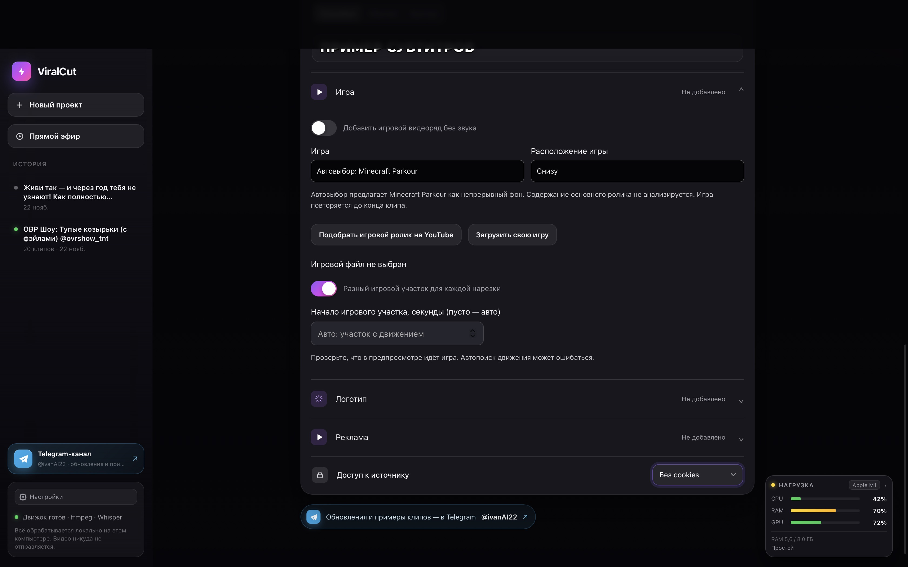
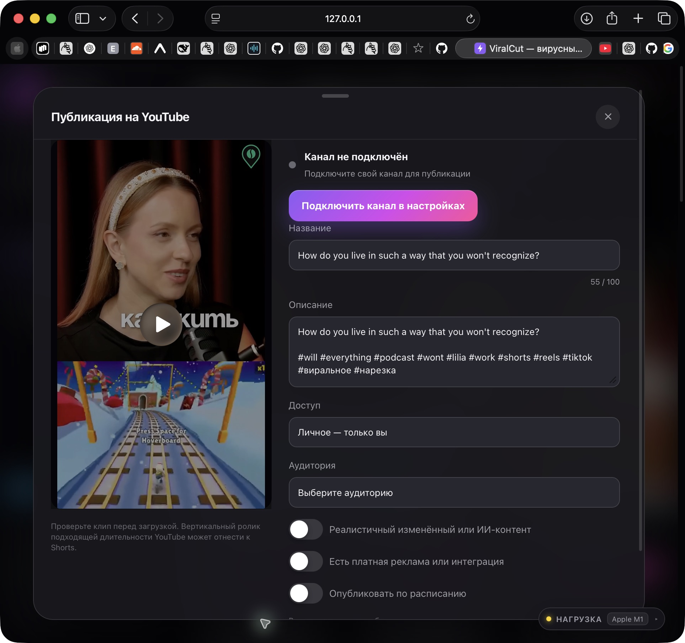

<p align="center">
  
</p>

<h1 align="center">ViralCut · расширенный форк</h1>

<p align="center">
  <b>Найти видео → нарезать → оформить → отправить на YouTube.</b><br/>
  Рекомендации YouTube, игровой видеоряд, свой логотип, рекламные вставки<br/>
  и публикация клипов — в одном локальном приложении.
</p>

<p align="center">
  
  
  
  <a href="LICENSE"></a>
</p>

<p align="center">
  <a href="https://github.com/Mr-X-01/viralcut/archive/refs/heads/main.zip"><b>Скачать исходники</b></a>
  &nbsp;·&nbsp; <a href="#быстрый-запуск">Запуск</a>
  &nbsp;·&nbsp; <a href="#скриншоты-новых-функций">Скриншоты</a>
  &nbsp;·&nbsp; <a href="#подключение-youtube">Подключение YouTube</a>
</p>

Форк [Mr-X-01](https://github.com/Mr-X-01), основанный на
[ViralCut 1.5.9 автора vanwild11](https://github.com/vanwild11/viralcut).
Изменения предложены автору в [pull request #3](https://github.com/vanwild11/viralcut/pull/3).
Готовые сборки оригинального проекта соответствуют его собственной версии;
расширенные функции этого форка доступны в исходниках здесь.

## Обновление базы до 1.5.9

Перенесены новый главный экран с примером кадрирования, панели параметров,
обновлённые редактор, настройки и экран эфира, а также действия MP4/SRT в карточках.
Виджет нагрузки по умолчанию свёрнут в боковой панели. Сохранены функции форка:
рекомендации YouTube, игра с разными участками, логотип, реклама и публикация.

Также перенесены исправления аудиодорожек и тайминга SRT после удаления пауз,
защита предыдущего экспорта при ошибке пересборки и улучшения кодирования GPU
с уведомлением о переходе на CPU в Windows. Композиция выполняется до замены
готового MP4; при её ошибке прежний экспорт остаётся доступен.

Окно настроек проверено в Safari на компьютере и при ширине 390 px.
Реальная работа аппаратного кодирования в Windows на этой машине не проверялась.
Скриншоты функций ниже сделаны до обновления оформления 1.5.9.

## Что добавлено

| Функция | Что можно сделать |
|---|---|
| **Рекомендации YouTube** | Выбрать русскую или английскую подборку, тему либо свой запрос, найти исходник и подтвердить скачивание. |
| **Видео с игрой** | Добавить игру сверху или снизу, загрузить свой файл или подобрать запись на YouTube. |
| **Разные игровые участки** | Для каждой нарезки используется своя точка старта. Новая YouTube-запись берётся из середины, затем ищется участок с движением. |
| **Свой логотип** | Выбрать угол и размер, сохранить прозрачность PNG или убрать однотонную подложку. |
| **Рекламная вставка** | Загрузить рекламный ролик, вставить его в паузе и продолжить основное видео с того же места. |
| **Публикация в YouTube** | Проверить клип, изменить название и описание, выбрать доступ, аудиторию и время публикации. |

Настройки игры, логотипа и рекламы находятся прямо в **«Параметрах нарезки»**.
Используются переключатели в стиле остальных настроек. Для готового проекта
можно применить композицию ко всем клипам и пересобрать их из исходника.

## Скриншоты новых функций

### Игра, логотип и реклама внутри параметров нарезки

Выбор источника игры, положения, разных участков и ручного начала находится на
той же странице, что формат, кадрирование и субтитры. Блоки раскрываются отдельно.



### Предпросмотр и публикация в YouTube

Название, описание, доступ и переключатели публикации оформлены в общем стиле.
На скриншоте показано состояние до подключения канала.



### Пример готовой композиции

Основной ролик занимает 60% высоты, игра — 40%. Игровая аудиодорожка отключена,
логотип наложен поверх результата. Кадр взят из реальной проверки рендера.

<p align="center">
  
</p>

## Как это работает

1. Вставьте ссылку, загрузите свой файл или найдите видео через **«Найти видео на YouTube»**.
2. Выберите качество и подтвердите скачивание.
3. Настройте формат, длительность, субтитры, игровой ряд, логотип и рекламу.
4. Приложение распознает речь через Whisper, выберет моменты и соберёт клипы через FFmpeg.
5. Просмотрите результат, скачайте MP4/ZIP или нажмите **«На YouTube»** у готового клипа.

Распознавание речи, отбор моментов и монтаж выполняются на компьютере.
Поиск и скачивание обращаются к источнику видео; публикация отправляет выбранный
MP4 в YouTube только после нажатия кнопки загрузки.

## Использование с телефона

Интерфейс адаптирован под узкие экраны: компактная навигация, формы в одну
колонку, увеличенные области нажатия и окна с учётом высоты мобильного экрана.
Настройки игры, логотипа, рекламы и публикации используют общие мобильные стили.
Панель нагрузки по умолчанию свёрнута на телефоне и располагается под диалогами.

Главная страница визуально проверена в режиме адаптивного дизайна Safari на
ширине **320 и 390 px**. Синтаксис JavaScript проверен; полная проверка всех
сценариев на физических устройствах пока не проводилась.

При размещении приложения на сервере мобильная вёрстка сохраняется. Текущая
авторизация YouTube рассчитана на локальный запуск через Desktop OAuth:
подключение канала из браузера телефона к удалённому серверу требует отдельной
адаптации OAuth. Мобильная вёрстка сама по себе не превращает приложение в
готовый многопользовательский сервис.

## Быстрый запуск

### macOS / Linux — в браузере

Нужен Python 3.12 или новее.

```bash
git clone https://github.com/Mr-X-01/viralcut.git
cd viralcut
./run.sh
```

Откройте [http://127.0.0.1:8765](http://127.0.0.1:8765).
Первый запуск создаёт виртуальное окружение и устанавливает зависимости.
FFmpeg поставляется через `imageio-ffmpeg`; при отсутствии локальной модели
Whisper приложение попробует скачать её при распознавании.

### Windows 10/11 — локальный сайт в браузере

Установите **Python 3.12 x64**, скачайте исходники и распакуйте архив.
Откройте PowerShell в папке проекта и выполните:

```powershell
py -3.12 run_web.py
```

При первом запуске создаётся `.venv-web` и устанавливаются зависимости из
`requirements.txt`. Затем откроется браузер с **http://127.0.0.1:8765/**.
BAT-файл, сборка EXE приложения и WebView2 для этого режима не нужны.
Python и локальный сервер необходимы для обработки видео.

Оставьте терминал открытым, пока пользуетесь сайтом. Для остановки нажмите
**Ctrl+C**. Чтобы запустить снова, выполните ту же команду. Если порт занят:

```powershell
py -3.12 run_web.py --port 8770
```

Сервер по умолчанию доступен только на этом компьютере. Проекты, клипы и модели
хранятся в папке `data` проекта (или в пути из `VIRALCUT_DATA`). При первом
распознавании может потребоваться скачивание модели Whisper.

Для подготовленного Python-окружения: `python -m viralcut --open-browser`.
Подробнее: [Windows](docs/WINDOWS.md).

### Сборка настольного приложения

- macOS: `./build_app.sh` → `dist/ViralCut.app`.
- Windows: `powershell -ExecutionPolicy Bypass -File build_windows.ps1`.

Модель Whisper, видео проектов, готовые клипы и локальное окружение не входят
в архив исходников репозитория.

## Подключение YouTube

1. В Google Cloud создайте проект и включите **YouTube Data API v3**.
2. Настройте OAuth consent screen; в режиме Testing добавьте свой аккаунт в Test users.
3. Создайте OAuth client ID типа **Desktop app** и скачайте JSON.
4. В ViralCut откройте **Настройки → YouTube → Выбрать OAuth-файл**.
5. Нажмите **«Подключить канал»** и подтвердите доступ в окне Google.

После подключения у готового клипа доступна отправка с предпросмотром, названием,
описанием, выбором аудитории и доступа. По умолчанию видео загружается как **личное**.
Для расписания загрузка выполняется сейчас, а открытый доступ включает YouTube
в выбранное время. YouTube самостоятельно определяет, относится ли видео к Shorts.

Токены хранятся через `keyring` в системном хранилище паролей. Вход использует
OAuth со state и PKCE. Есть фоновая очередь, прогресс, отмена и защита от повторной
отправки неизменённого файла. Реальная отправка в пользовательский канал пока
не проверялась: тесты OAuth и загрузки выполнялись без отправки видео в Google.

[Подробности функций и ограничений →](docs/FEATURES.md)

## Что важно учитывать

- **Рекомендации:** язык предполагается по заголовку. Просмотры общие; состав
  русской/английской аудитории не измеряется. Это подборка результатов поиска,
  а не полный рейтинг YouTube и не прогноз просмотров.
- **Игра:** поиск движения может ошибиться. Есть предпросмотр и ручное начало.
  На коротком исходнике участки могут пересекаться и повторяться.
- **Реклама:** выбирается подходящая пауза возле середины; если её нет — середина
  клипа. Смысловая граница фразы нейросетью не определяется.
- **Субтитры:** встроенные в видео субтитры останавливаются на рекламе вместе
  с основным роликом. Отдельный SRT остаётся на шкале исходного фрагмента.
- **Материалы:** используйте видео и игровые записи с разрешением на обработку
  и публикацию.

## Проверки

На macOS Apple Silicon / Python 3.13:

- **140 тестов**, из них **8 пропущены**, ошибок нет.
- Проверены реальные выдачи YouTube для русской, английской и игровой подборок.
- Проверен FFmpeg-монтаж игры сверху/снизу, логотипа и немой рекламной вставки.
- Пересобраны 10 реальных клипов с разными точками старта игрового ряда.
- В Safari проверены встроенные настройки, переключатели и окно публикации.
- OAuth, очередь, отмена, прогресс и защита от повторов проверены изолированными
  тестами без отправки видео в YouTube.

```bash
python -m unittest discover -s tests -p 'test_*.py'
node --check web/app.js
```

## Авторство и лицензия

Оригинальное приложение — [vanwild11/viralcut](https://github.com/vanwild11/viralcut).
Дополнения в этом форке — [Mr-X-01](https://github.com/Mr-X-01).

Лицензия [MIT](LICENSE). Лицензии сторонних компонентов:
[THIRD_PARTY_NOTICES.md](THIRD_PARTY_NOTICES.md).
